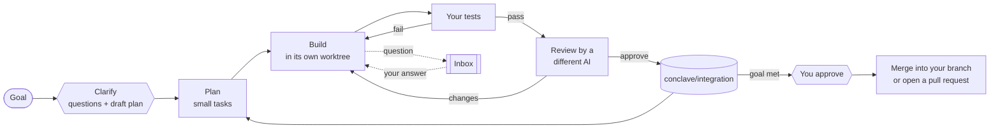

<h1 align="center">Conclave</h1>

<p align="center">
  <b>Your AI coding subscriptions, working as one team.</b><br />
  A desktop app that plans, builds, tests and cross-reviews whole projects with Claude Code, OpenAI Codex and Google Antigravity, using the CLIs you already pay for.
</p>

<p align="center">
  <a href="https://github.com/MarcoWithoutPolo/conclave/actions/workflows/ci.yml"></a>
  
  
  <a href="LICENSE"></a>
</p>

<picture>
  <source media="(prefers-color-scheme: dark)" srcset="docs/images/project-needs-you-dark.png" />
  
</picture>

## What it does

You give Conclave a goal and a folder. It splits the goal into small tasks. Then, for each task, one AI builds it in its own git worktree, your tests run, and a **different** AI reviews the diff. Good work is merged into a separate branch. Nothing reaches your own branch, or GitHub, until you approve it.

- **Projects:** an autonomous loop that can run for hours. It paces itself against each subscription's usage limits and hands work to the next AI when one runs out.
- **Council:** ask every AI at once, see their answers side by side, and get one merged answer with citations and the points where they disagree.
- **Chat:** talk to any of them, and pick the model and reasoning effort for each conversation.

## Highlights

|                                                                                                                                                                                                                                                                                                                                                                                                                                            |                                                                                                                                                                                                                                                                                                                                                                                                                         |
| ------------------------------------------------------------------------------------------------------------------------------------------------------------------------------------------------------------------------------------------------------------------------------------------------------------------------------------------------------------------------------------------------------------------------------------------ | ----------------------------------------------------------------------------------------------------------------------------------------------------------------------------------------------------------------------------------------------------------------------------------------------------------------------------------------------------------------------------------------------------------------------- |
| <picture><source media="(prefers-color-scheme: dark)" srcset="docs/images/new-project-clarify-dark.png" /></picture> **Asks before it guesses.** A short questions step turns your answers into decisions every agent follows. Questions mid-run land in your Inbox while other work goes on.                    | <picture><source media="(prefers-color-scheme: dark)" srcset="docs/images/council-dark.png" /></picture> **A council of models.** One question, every AI, and one merged answer that shows where they agree and where they differ.                                                                           |
| <picture><source media="(prefers-color-scheme: dark)" srcset="docs/images/failure-card-dark.png" /></picture> **Failures explain themselves.** Each failure says what kind it is and whose problem it is: tests, review, a crashed CLI, a usage limit. Retry with another AI, a stronger model or more effort, or skip it. | <picture><source media="(prefers-color-scheme: dark)" srcset="docs/images/project-settings-permissions-dark.png" /></picture> **You set the permissions.** Five levels, from read-only to full access, each enforced by the CLI's own sandbox flags rather than by trusting the model. |
| <picture><source media="(prefers-color-scheme: dark)" srcset="docs/images/inbox-question-dark.png" /></picture> **One Inbox.** Agents' questions, package installs, merges, pull requests and new repositories all wait here for a yes from you.                                                                                           | <picture><source media="(prefers-color-scheme: dark)" srcset="docs/images/usage-limit-dark.png" /></picture> **Limits are not failures.** When an AI hits its plan or spend cap, its work moves to the next AI, with no attempts used, and the app tells you.                                    |

## How a project runs



- **One task per piece of work.** Retries reuse the task, and re-planned work replaces the failed task instead of adding a twin, so "3 of 7" means three of seven.
- **Crash-safe.** Every step is recorded. Close the app, or lose power, mid-build, and the interrupted task goes back in the queue when you reopen.
- **Escalating retries.** Attempt 2 thinks harder. Attempt 3 hands the task to the next builder on the team.

## Bring your own CLI

Conclave never asks for your passwords, API keys or tokens. It drives the official CLIs that you install and sign in to yourself, so every request runs under your own account and each provider's terms.

| Service            | CLI                                                               | Sign in                         |
| ------------------ | ----------------------------------------------------------------- | ------------------------------- |
| Claude Code        | `npm i -g @anthropic-ai/claude-code`                              | `claude`, then `/login`         |
| OpenAI Codex       | `npm i -g @openai/codex`                                          | `codex login`                   |
| Google Antigravity | [Install guide](https://antigravity.google/docs/install/) (`agy`) | `agy`, then sign in with Google |
| GitHub (optional)  | [GitHub CLI](https://cli.github.com/) (`gh`)                      | `gh auth login --web`           |

The Accounts screen shows what's installed and connected, opens each sign-in in a terminal, and shows each plan's usage where the CLI reports it.

## Get started

Requires Node.js 22.13 or newer, and git.

```bash
git clone https://github.com/MarcoWithoutPolo/conclave.git
cd conclave
npm install
npm run desktop                  # the app, with hot reload
```

To try it without any accounts, run the offline demo, which uses fake providers and costs nothing:

```bash
CONCLAVE_DEMO=1 npm run desktop
```

### From the terminal

```bash
npm run conclave -- doctor --live              # which AIs are connected
npm run conclave -- chat --use claude:opus     # chat; /use codex switches mid-chat
npm run conclave -- ask "..."                  # council: everyone answers, one merged result
npm run conclave -- project new ./my-repo --goal "..." --test "npm test"
npm run conclave -- project run <id>           # work until the goal is met
npm run conclave -- project status <id>
```

Data lives in `~/.conclave` (set `CONCLAVE_HOME` to move it).

## Safety

- **Your branch is never touched.** All work happens on `conclave/integration` in separate worktrees. Merging into your branch, pushing, opening pull requests and creating repositories always wait for your approval.
- **Permissions are enforced by each CLI's sandbox.** Planners and reviewers only read. Builders default to editing files with no network. Higher levels are opt-in, and full access expires after 24 hours.
- **Installs go through you.** An agent that needs a package asks first. Once you approve, Conclave runs that exact command itself, and package folders are kept out of git.
- **No credentials, ever.** Sign-in is always the provider's own login flow.

## Project status

v0.6, the private beta, is complete. It was tested live on real Claude, Codex, Antigravity and GitHub accounts across seven scenarios: an empty folder to a finished project, usage limits, a three-AI team, permission levels, package installs, a GitHub pull request with CI, and crash recovery. See [docs/DIRECTION.md](docs/DIRECTION.md) for the results.

| Next | Focus                                                                                         |
| ---- | --------------------------------------------------------------------------------------------- |
| v0.7 | **Faster:** parallel tasks, daily budgets and quiet hours, steering a running project by chat |
| v0.8 | **See it:** live preview of web projects, screenshot-based visual review                      |
| v0.9 | **More AIs:** GitHub Copilot, Cursor, OpenCode, Amp                                           |
| v1.0 | **Ship it:** installer, auto-update, tray notifications, an MCP server for other AI tools     |

The full plan is in [docs/PLAN-v2.md](docs/PLAN-v2.md).

## Development

```text
packages/shared   zod schemas and types shared by the engine and the app
packages/core     the engine: adapters, chat, council, brain, governor, store, GitHub
apps/cli          the `conclave` command
apps/desktop      Electron + React app (Tailwind, zustand)
test/fixtures     recorded CLI output that the adapter tests replay
```

```bash
npm run check                    # lint, format, typecheck, unit tests
npm run e2e                      # build, then drive the real app (demo mode) with Playwright
```

Every adapter maps its CLI's output onto one event format, and tests replay recorded output, so nothing above the adapter layer depends on a particular CLI. Live checks against the real CLIs are opt-in: `CONCLAVE_LIVE=1 npm test`, and the private-test scenarios in `apps/desktop/e2e/scenario-*.spec.ts`.

## License

[MIT](LICENSE)
