<h1 align="center">Conclave</h1>

<p align="center">
  <b>Your AI coding subscriptions, working as one team.</b><br />
  A desktop app that plans, builds, tests and cross-reviews whole projects with Claude Code, OpenAI Codex and Google Antigravity, using the CLIs you already pay for.
</p>

<p align="center">
  <a href="https://github.com/MarcoWithoutPolo/conclave/actions/workflows/ci.yml"></a>
  
  
  <a href="LICENSE"></a>
</p>

<picture>
  <source media="(prefers-color-scheme: dark)" srcset="docs/images/project-lanes-dark.png" />
  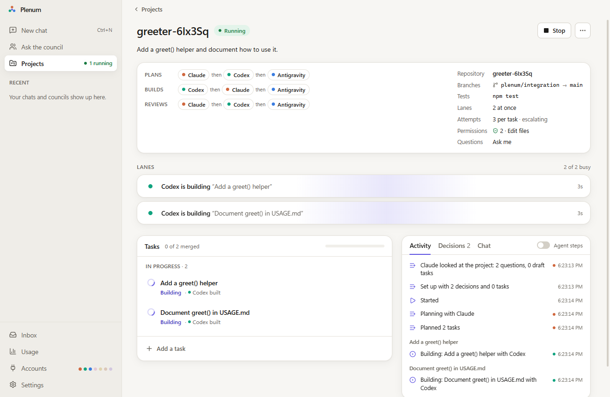
</picture>

## What it does

You give Conclave a goal and a folder. It splits the goal into right-sized tasks. Then, for each task, one AI builds it in its own git worktree, your tests run, and a **different** AI reviews the diff. Independent tasks build at the same time. Good work is merged into a separate branch, re-tested when other work landed first. Nothing reaches your own branch, or GitHub, until you approve it.

- **Projects:** an autonomous loop that can run for hours. It paces itself against each subscription's usage limits, hands work to the next AI when one runs out, and you can steer it while it runs.
- **Council:** ask every AI at once, see their answers side by side, and get one merged answer with citations and the points where they disagree.
- **Chat:** talk to any of them, and pick the model and reasoning effort for each conversation.
- **Any AI you have:** Claude Code, Codex, Antigravity, GitHub Copilot, Cursor and Grok Build through their own signed-in CLIs, and local models through Ollama and OpenCode.

## Highlights

|                                                                                                                                                                                                                                                                                                                                                                                                                                                                                                                                           |                                                                                                                                                                                                                                                                                                                                                                                                                                                                                                                                                                   |
| ----------------------------------------------------------------------------------------------------------------------------------------------------------------------------------------------------------------------------------------------------------------------------------------------------------------------------------------------------------------------------------------------------------------------------------------------------------------------------------------------------------------------------------------- | ----------------------------------------------------------------------------------------------------------------------------------------------------------------------------------------------------------------------------------------------------------------------------------------------------------------------------------------------------------------------------------------------------------------------------------------------------------------------------------------------------------------------------------------------------------------- |
| <picture><source media="(prefers-color-scheme: dark)" srcset="docs/images/project-lanes-dark.png" /></picture><br />**Parallel lanes.** Independent tasks build at the same time, each AI within its lane cap. Tasks that touch the same files wait for each other, and every merge is re-tested on top of whatever landed first.                                                                                                                       | <picture><source media="(prefers-color-scheme: dark)" srcset="docs/images/project-chat-proposal-dark.png" />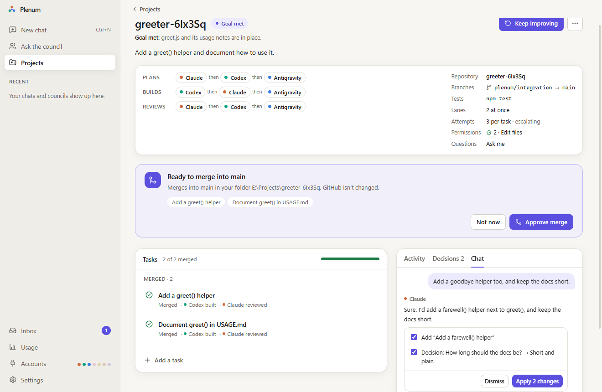</picture><br />**Steer it while it runs.** Tell a project what to change in plain words. Its planner proposes the changes; nothing happens until you tick what you want and apply it. Or move, edit, skip and add tasks on the board.                                                                       |
| <picture><source media="(prefers-color-scheme: dark)" srcset="docs/images/settings-dark.png" />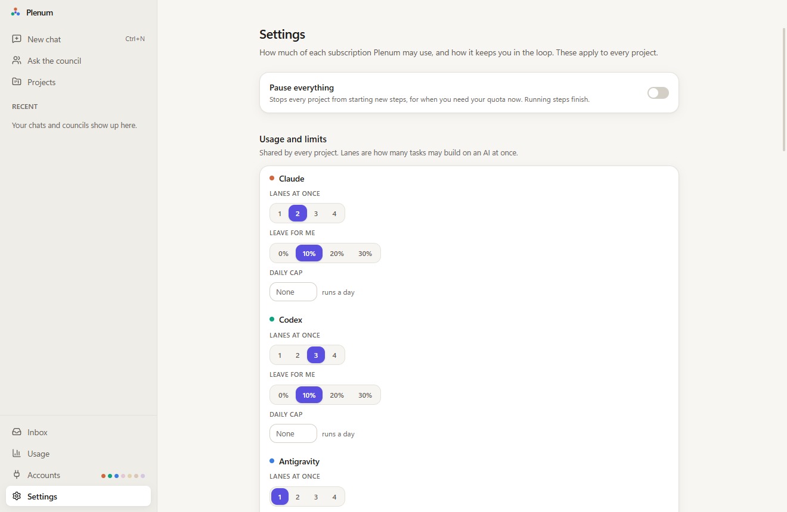</picture><br />**Shared limits.** Lanes per AI across every project, a share of each plan left for your own use, daily caps, quiet hours and one Pause everything switch. Every wait says why and until when.                                                                                             | <picture><source media="(prefers-color-scheme: dark)" srcset="docs/images/project-settings-team-dark.png" />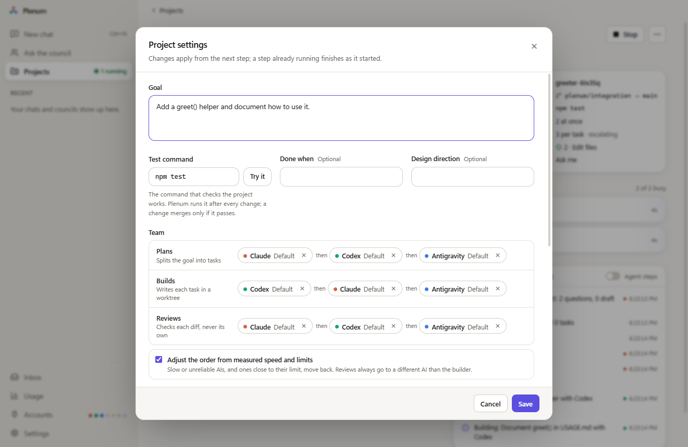</picture><br />**Picks AIs from measured data.** Slow, unreliable or nearly spent AIs move back in the order, and the team screen says why. A different AI than the builder always reviews.                                                                                                                                   |
| <picture><source media="(prefers-color-scheme: dark)" srcset="docs/images/new-project-clarify-dark.png" />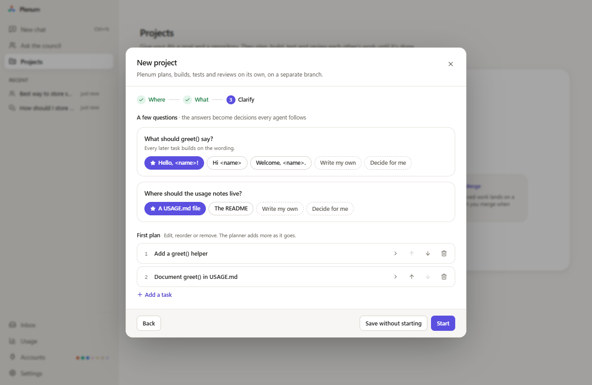</picture><br />**Asks before it guesses.** A short questions step turns your answers into decisions every agent follows. Questions mid-run land in your Inbox while other work goes on.                                                                                                              | <picture><source media="(prefers-color-scheme: dark)" srcset="docs/images/council-dark.png" />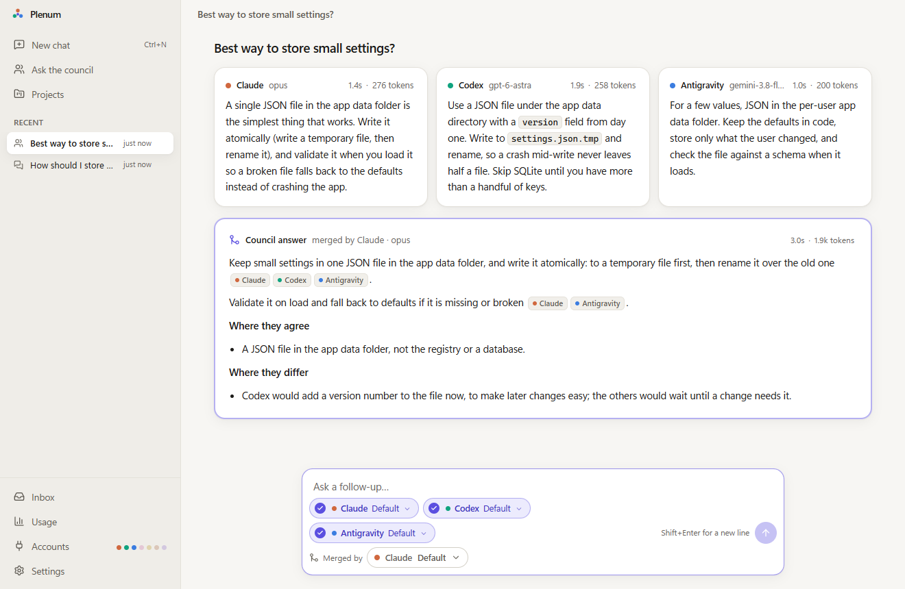</picture><br />**A council of models.** One question, every AI, and one merged answer that shows where they agree and where they differ.                                                                                                                                                                                                                |
| <picture><source media="(prefers-color-scheme: dark)" srcset="docs/images/failure-card-dark.png" />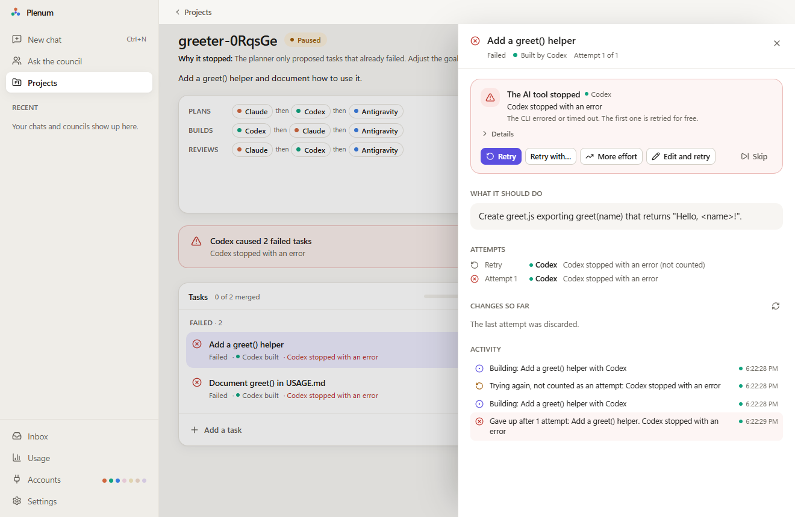</picture><br />**Failures explain themselves.** Each failure says what kind it is and whose problem it is: tests, review, a crashed CLI, a usage limit. Retry with another AI, a stronger model or more effort, or skip it.                                                                                           | <picture><source media="(prefers-color-scheme: dark)" srcset="docs/images/project-settings-permissions-dark.png" />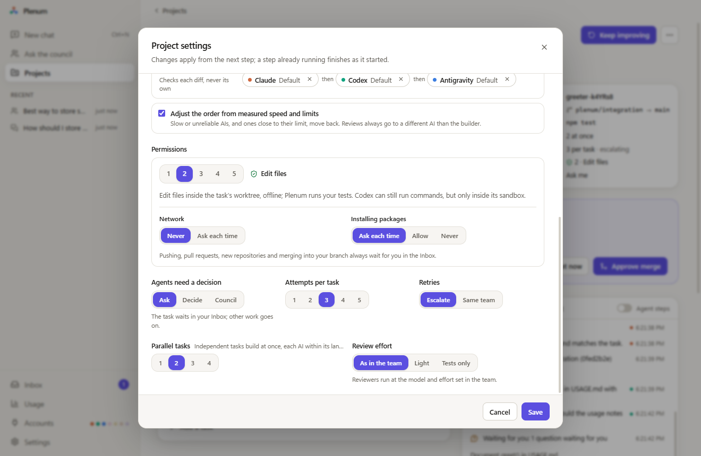</picture><br />**You set the permissions.** Five levels, from read-only to full access, each enforced by the CLI's own sandbox flags rather than by trusting the model.                                                                                                                                      |
| <picture><source media="(prefers-color-scheme: dark)" srcset="docs/images/inbox-question-dark.png" />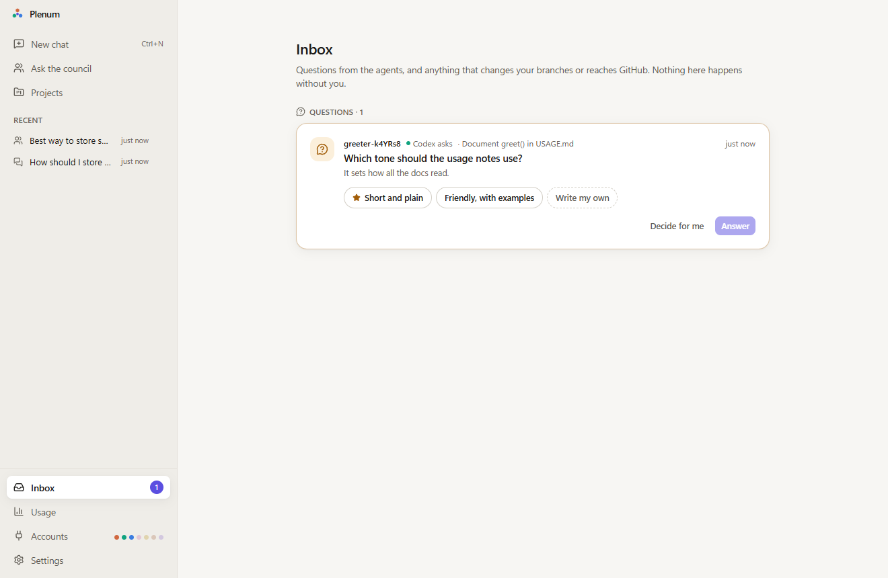</picture><br />**One Inbox.** Agents' questions, package installs, merges, pull requests and new repositories all wait here for a yes from you.                                                                                                                                                                                     | <picture><source media="(prefers-color-scheme: dark)" srcset="docs/images/usage-limit-dark.png" />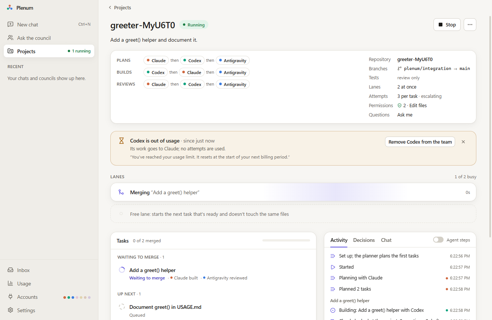</picture><br />**Limits are not failures.** When an AI hits its plan or spend cap, its work moves to the next AI, with no attempts used, and the app tells you.                                                                                                                                                                         |
| <picture><source media="(prefers-color-scheme: dark)" srcset="docs/images/preview-dark.png" />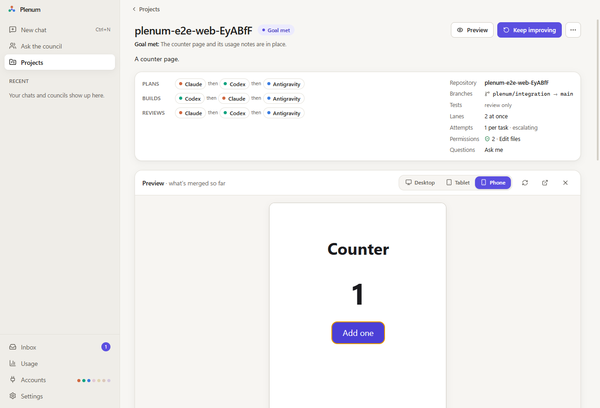</picture><br />**Live preview.** Web projects open inside the app at desktop, tablet or phone width: what's merged so far, or one task's change while it builds. Static sites are served by Conclave; a project's own dev server runs only after you allow it.                                                                             | <picture><source media="(prefers-color-scheme: dark)" srcset="docs/images/visual-failure-dark.png" />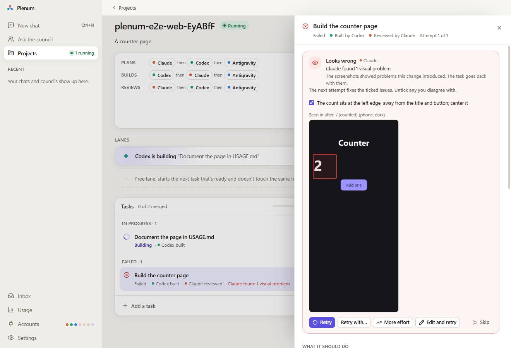</picture><br />**It looks at the result.** Every task in a web project is screenshotted at desktop and phone width, light and dark, and checked for contrast, small tap targets, sideways scrolling and console errors. A reviewer that can see reads the screenshots too, and visual problems go back to the builder. |
| <picture><source media="(prefers-color-scheme: dark)" srcset="docs/images/screenshots-first-dark.png" />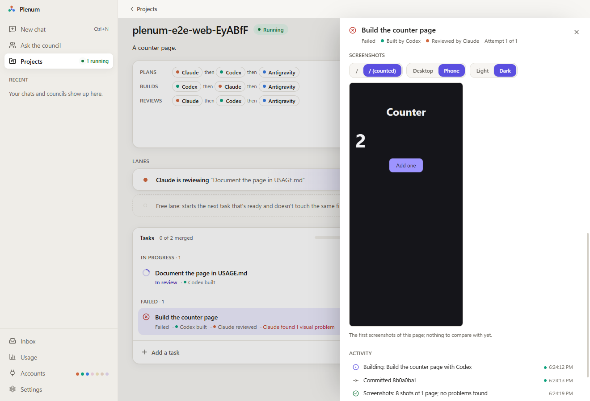</picture><br />**Before and after.** Each task's drawer shows its screenshots next to what was merged before, side by side or with a slider, with the changed areas outlined.                                                                                                                                                 | <picture><source media="(prefers-color-scheme: dark)" srcset="docs/images/start-check-dark.png" />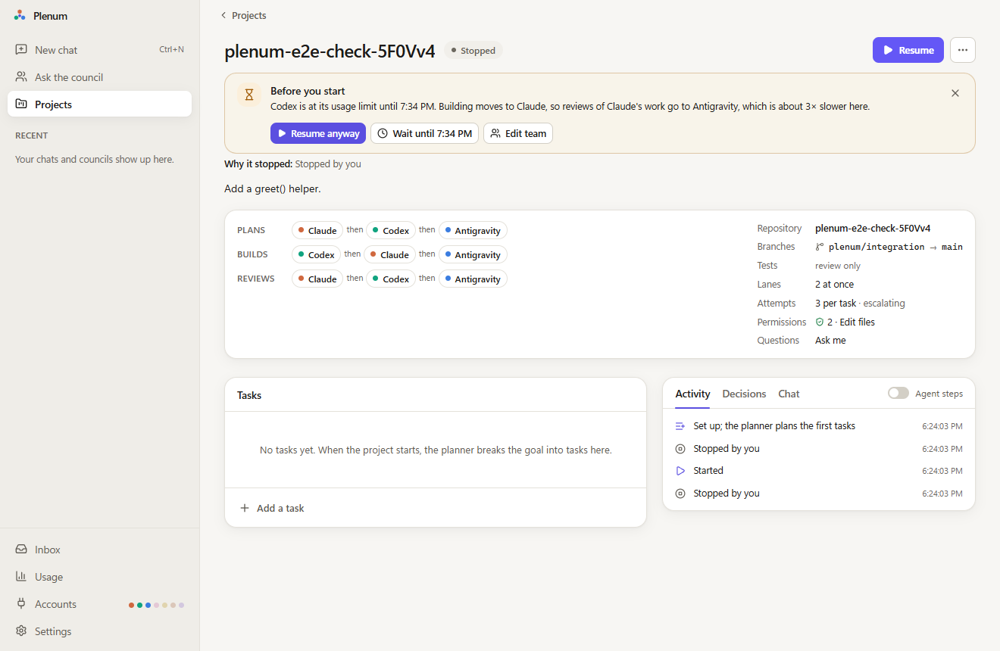</picture><br />**Says what a limit changes, before it starts.** If an AI on the team can't work right now, Start explains who takes over (and if that's a much slower reviewer), with Start anyway, Wait until it's back, or Edit team. A slow review gets a backup from a faster AI; the first verdict wins.           |
| <picture><source media="(prefers-color-scheme: dark)" srcset="docs/images/picker-cursor-dark.png" />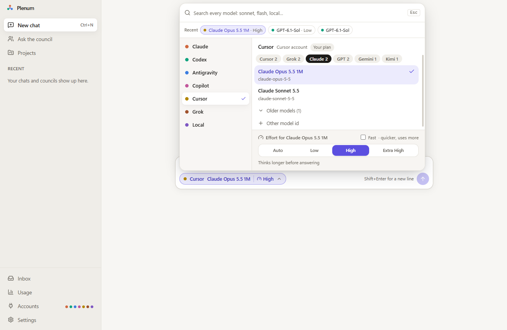</picture><br />**Seven AIs, one picker.** Claude Code, Codex, Antigravity, GitHub Copilot, Cursor, Grok Build and local models. Each one's models come from its own CLI, with its own effort levels in its own words. Search across all of them; long lists fold by maker and generation. | <picture><source media="(prefers-color-scheme: dark)" srcset="docs/images/picker-local-dark.png" />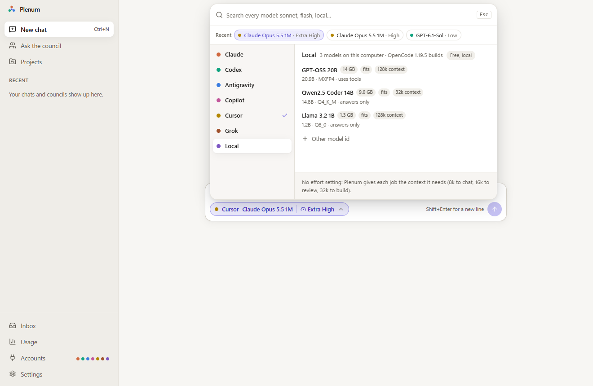</picture><br />**Models on your own hardware.** Ollama answers chats, councils and reviews; OpenCode lets a local model build. Each model says whether it fits your GPU, and a bigger machine on your network can serve them. Free, private, and never paused for usage.                                                |

## How a project runs

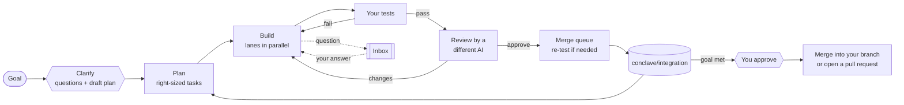

- **Right-sized plans.** The planner estimates each task's size and risk; tiny tasks are folded together and oversized ones are split, because every task pays for a build, a test run and a review.
- **The last review checks the whole goal**, so the project finishes without an extra planner round, or the gaps go into the next plan.
- **One task per piece of work.** Retries reuse the task, and re-planned work replaces the failed task instead of adding a twin, so "3 of 7" means three of seven.
- **Crash-safe.** Every step is recorded. Close the app, or lose power, mid-build, and the interrupted task goes back in the queue when you reopen.
- **Escalating retries.** Attempt 2 thinks harder. Attempt 3 hands the task to the next builder on the team.

## Does it beat one AI on its own?

We measure it. [`bench/`](bench/) gives the same goal to Claude Code, Codex and Antigravity on their own and to Conclave, and scores each result with hidden acceptance tests no agent ever sees. There are four projects, from a small library to a multi-module accounting toolkit with a parser and a CLI.

| Project (hidden tests)    | Conclave v0.6 | **Conclave v0.7**   | Claude alone | Codex alone    | Antigravity alone |
| ------------------------- | ------------- | ------------------- | ------------ | -------------- | ----------------- |
| textkit, small (7)        | 10.1 min      | **2.7 min**, 7/7    | 1.1 min      | 2.7 min        | 7.8 min           |
| inventory, refactor (7)   | 12.6 min      | **3.3 min**, 7/7    | 1.3 min      | 2.5 min        | 6.7 min           |
| calc, medium (7)          | 19.7 min      | **6.3 min**, 7/7    | 1.5 min      | 4.2 min        | 16.8 min, one 6/7 |
| ledger, multi-module (12) | n/a           | **15.3 min**, 12/12 | 2.8 min      | 9.4 min, 11/12 | 36.0 min          |

- **Quality held:** Conclave passed every hidden test in all eight runs. Codex alone and Antigravity alone each missed one.
- **v0.7 is 3–4× faster than v0.6**, with 3–6× fewer tokens, and on small projects it's on par with Codex alone.
- **v0.8 keeps that and checks the looks.** On the four projects above it passed every hidden test again (2 runs each). A fifth project, a kanban web app with 12 hidden checks in a real browser, scored 12/12 in all 12 runs. In one, the free screenshot checks sent back a build whose text was too faint in dark mode, which would otherwise have merged. Visual review costs under 1% of tokens.
- **v0.9 adds the new AIs.** Alone at level 2, Copilot Free passed 7/7 on every small project in about a minute; Cursor's and Grok's free plans ran out after about one project; a 20B local model failed most hidden tests. In Conclave, a five-AI team passed every hidden test, and so did a team with the local model first in line: its failed attempts moved on to the next builder (after a fix the benchmark prompted), at the cost of time.
- **It's slower than Claude alone.** A second AI reviews every change, and when Codex is out of usage, that reviewer is Antigravity, which is slow. Claude alone is the fastest single tool on well-specified work. Conclave's case is the review, carrying on through usage limits (Codex ran out mid-benchmark; Conclave lost nothing), and long unattended runs.

Full results, per-role timings and what changed between runs: [bench/RESULTS.md](bench/RESULTS.md).

## Bring your own CLI

Conclave never asks for your passwords, API keys or tokens. It drives the official CLIs that you install and sign in to yourself, so every request runs under your own account and each provider's terms.

| Service            | CLI                                                                                            | Sign in                         |
| ------------------ | ---------------------------------------------------------------------------------------------- | ------------------------------- |
| Claude Code        | `npm i -g @anthropic-ai/claude-code`                                                           | `claude`, then `/login`         |
| OpenAI Codex       | `npm i -g @openai/codex`                                                                       | `codex login`                   |
| Google Antigravity | [Install guide](https://antigravity.google/docs/install/) (`agy`)                              | `agy`, then sign in with Google |
| GitHub Copilot     | `npm i -g @github/copilot`                                                                     | `copilot login`                 |
| Cursor             | [Install guide](https://cursor.com/docs/cli/installation) (`cursor-agent`)                     | `cursor-agent login`            |
| Grok Build         | [Install guide](https://docs.x.ai/build/overview) (`grok`)                                     | `grok login`                    |
| Local models       | [Ollama](https://ollama.com/download), plus [OpenCode](https://opencode.ai/docs/cli/) to build | none                            |
| GitHub (optional)  | [GitHub CLI](https://cli.github.com/) (`gh`)                                                   | `gh auth login --web`           |

The Accounts screen shows what's installed and connected, opens each sign-in in a terminal, and shows each plan's usage where the CLI reports it.

## Get started

### Install

Download the installer for your system from the [latest release](https://github.com/MarcoWithoutPolo/conclave/releases/latest):

- **Windows:** `Conclave-Setup-<version>.exe`. It installs for you alone, with no administrator prompt. The installer
  isn't signed yet, so Windows SmartScreen may warn about it: choose **More info**, then **Run anyway**.
- **macOS:** `Conclave-<version>.dmg`. It isn't signed yet: the first time, right-click Conclave in Applications and
  choose **Open**.
- **Linux:** `Conclave-<version>.AppImage` (make it executable and run it) or the `.deb`.

The first start finds the AI CLIs you have, helps you sign in to each through its own login, and builds your team. One
AI is enough to start; two or more from different companies unlock councils, independent reviews and limit backup.

Installed copies update themselves from the releases: a new version downloads quietly and installs when you restart,
never while a project is building. Your data stays in `~/.conclave` through installs, updates and uninstalls, and the
database is backed up before any upgrade changes it.

**Known limits in 1.0**

- The installers aren't code-signed, so Windows and macOS warn on first run (see above). Signing needs a certificate
  Conclave doesn't have yet.
- 1.0 was tested on Windows. The macOS and Linux builds come from the same code and release workflow but haven't had
  the same hands-on run; please report what you find.
- Cursor's CLI can't limit which commands it runs, so Cursor builds at permission levels 1, 2 and 5 only; Conclave
  says so when you pick it.
- On Windows, a server an AI started and forgot to stop can outlive its run. Conclave no longer waits for it and stops
  what it can trace, but a stray `node` process may remain until you close it.

### Background mode

Closing the window can leave your projects working: Conclave stays in the system tray (the menu bar on a Mac), and the
tray menu shows what's running and what waits in the Inbox, and pauses or quits everything. Settings → Background
chooses what closing does and whether Conclave opens when you sign in to your computer.

### Use it from Claude Code (MCP)

Conclave is also an MCP server, so Claude Code or any MCP client can ask a council, see your projects and the Inbox,
queue a task and answer a project's question. Merges, pushes and installs still wait for you. Settings → About shows
the exact line for your install; it looks like this:

```bash
claude mcp add conclave -- "C:\Users\you\AppData\Local\Programs\Conclave\Conclave.exe" --mcp
```

From a clone, `npm --prefix <clone> run -s conclave -- mcp` does the same.

### From source

Requires Node.js 22.13 or newer, and git.

```bash
git clone https://github.com/MarcoWithoutPolo/conclave.git
cd conclave
npm install
npm run desktop                  # the app, with hot reload
```

To try it without any accounts, run the offline demo, which uses fake providers and costs nothing:

```bash
CONCLAVE_DEMO=1 npm run desktop
```

### From the terminal

```bash
npm run conclave -- doctor --live              # which AIs are connected
npm run conclave -- chat --use claude:opus     # chat; /use codex switches mid-chat
npm run conclave -- ask "..."                  # council: everyone answers, one merged result
npm run conclave -- project new ./my-repo --goal "..." --test "npm test" --parallel 2
npm run conclave -- project run <id>           # work until the goal is met
npm run conclave -- project steer <id> "..."   # tell it what to change (--apply to apply)
npm run conclave -- project status <id>
npm run conclave -- mcp                        # serve Conclave to an MCP client over stdio
```

Data lives in `~/.conclave` (set `CONCLAVE_HOME` to move it).

## Safety

- **Your branch is never touched.** All work happens on `conclave/integration` in separate worktrees. Merging into your branch, pushing, opening pull requests and creating repositories always wait for your approval.
- **Permissions are enforced by each CLI's sandbox.** Planners and reviewers only read. Builders default to editing files with no network. Higher levels are opt-in, and full access expires after 24 hours.
- **Installs go through you.** An agent that needs a package asks first. Once you approve, Conclave runs that exact command itself, and package folders are kept out of git.
- **No credentials, ever.** Sign-in is always the provider's own login flow.

## Project status

v0.9 is complete: GitHub Copilot, Cursor and Grok Build join Claude Code, Codex and Antigravity, and local models run through Ollama (chat and reviews) and OpenCode (building). One picker reaches every model and effort, with each list read from the CLI itself. Finishing can merge here and push to GitHub, and the test command explains itself. It was tested live across scenarios 15–20 on real accounts, including a seven-AI council. See [docs/PLAN-v0.9.md](docs/PLAN-v0.9.md) and [bench/RESULTS.md](bench/RESULTS.md).

| Next | Focus                                                                                     |
| ---- | ----------------------------------------------------------------------------------------- |
| v1.0 | **Ship it:** installer, auto-update, tray notifications, an MCP server for other AI tools |

The full plan is in [docs/PLAN-v2.md](docs/PLAN-v2.md).

## Development

```text
packages/shared   zod schemas and types shared by the engine and the app
packages/core     the engine: adapters, chat, council, brain, governor, store, GitHub
apps/cli          the `conclave` command
apps/desktop      Electron + React app (Tailwind, zustand)
test/fixtures     recorded CLI output that the adapter tests replay
```

```bash
npm run check                    # lint, format, typecheck, unit tests
npm run e2e                      # build, then drive the real app (demo mode) with Playwright
npm run -w @conclave/desktop dist   # the installer for this system, in apps/desktop/release/
npx tsx --conditions=development bench/soak.ts --minutes 10   # the chaos soak (Q4)
```

Every adapter maps its CLI's output onto one event format, and tests replay recorded output, so nothing above the adapter layer depends on a particular CLI. Live checks against the real CLIs are opt-in: `CONCLAVE_LIVE=1 npm test`, and the private-test scenarios in `apps/desktop/e2e/scenario-*.spec.ts`.

## License

[MIT](LICENSE)
